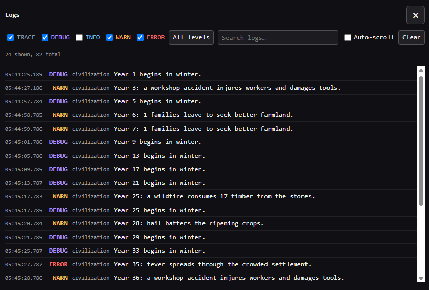

<div align="center">

  <h1>👾 Examplify</h1>

  <p>
    <a href="https://github.com/egakareta/examplify/actions/workflows/ci.yml"></a>
    <a href="https://crates.io/crates/examplify"></a>
  </p>

  
</div>

## About

Examplify is a lightweight logging UI for Rust web applications. It uses the
[`log`](https://crates.io/crates/log) facade and adds a searchable, filterable
console overlay to WebAssembly apps. On native targets, it forwards log records
to `env_logger`.

Its primary motivation is to provide an ultra-simple way for libraries to show
`examples/` in the web without having to stitch together `js-sys` or possibly a
much heavier crate like `eframe`.

## Usage

```rust
use examplify::log;

fn main() {
    examplify::init().with_log_level(log::LevelFilter::Info);
    log::info!("Application started");
    log::warn!("Something needs attention");
}
```

`examplify::init()` installs the logger for the current target. If another
logger might already be installed, use `examplify::try_init()` to handle that
case:

```rust
if let Err(error) = examplify::try_init() {
    eprintln!("Could not install Examplify logger: {error}");
}
```

## License

Dual-licensed under the [MIT License](https://opensource.org/licenses/MIT) and the [Apache License, Version 2.0](https://www.apache.org/licenses/LICENSE-2.0). Choose whichever you prefer. This license only applies to Examplify code.

By submitting a contribution, including code submitted through a pull request, you agree that your contribution will be dual-licensed under the MIT License and the Apache License, Version 2.0, without any additional terms or conditions.
